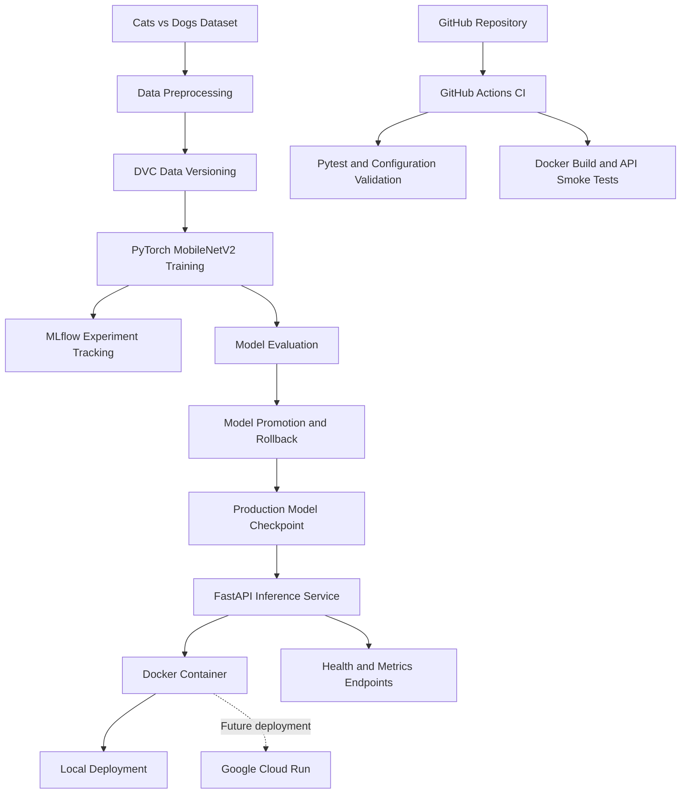

# Cats vs Dogs — End-to-End MLOps Project

[](https://github.com/tarekhussein/cats-dogs-mlops/actions/workflows/ci.yml)


## Overview

An end-to-end Machine Learning Operations (MLOps) project
demonstrating the complete lifecycle of a deep learning model,
from dataset versioning and experiment tracking to automated
testing, containerized inference, monitoring, and model governance.

The project implements binary image classification using
a pretrained MobileNetV2 architecture with PyTorch.

It combines reproducible machine learning workflows with
software engineering and deployment practices.

## Key Results

| Metric | Result |
|---|---|
| Model architecture | MobileNetV2 |
| Validation accuracy | 98.00% |
| Test accuracy | 99.33% |
| Test samples | 300 |
| Correct predictions | 298 / 300 |
| Production Docker image | ~303 MB |
| Inference framework | FastAPI |
| Experiment tracking | MLflow |
| Data versioning | DVC |
| CI automation | GitHub Actions |
| Deployment | Local Docker |
| Cloud readiness | Google Cloud Run template |

## Project Objectives

- Develop and evaluate a deep learning image classifier.
- Version datasets and track machine learning experiments.
- Expose model inference through a REST API.
- Package the application in a reproducible Docker image.
- Automate testing and deployment verification with GitHub Actions.
- Implement model fingerprinting, promotion safeguards, and rollback.
- Monitor prediction requests and inference latency.
- Prepare for future cloud deployment without requiring paid services.

## Model Performance & Evaluation

The classification model uses MobileNetV2 with transfer
learning, implemented in PyTorch.

### Dataset

| Dataset Split | Images |
|---|---:|
| Training | 1,400 |
| Validation | 300 |
| Testing | 300 |
| **Total** | **2,000** |

The dataset was split into separate training, validation,
and test sets. Dataset preparation and versioning are
managed using DVC.

### Training Configuration

| Parameter | Value |
|---|---|
| Architecture | Pretrained MobileNetV2 |
| Framework | PyTorch |
| Task | Binary classification (Cat / Dog) |
| Training epochs | 5 |
| Random seed | 42 |
| Experiment tracking | MLflow |

### Evaluation Results

| Metric | Result |
|---|---:|
| Validation accuracy | 98.00% |
| Test accuracy | 99.33% |
| Correct test predictions | 298 |
| Incorrect test predictions | 2 |
| Test samples | 300 |

The model correctly classified 298 out of 300 images
in the held-out test dataset.

The validation set was used to assess performance during
development, while the separate test set was used for
final evaluation.

### Reproducibility

The project includes:

- Dataset versioning with DVC.
- Configurable training and evaluation scripts.
- Experiment tracking with MLflow.
- Fixed random seed for training.
- Production checkpoint fingerprinting with SHA-256.
- Automated tests for API behavior and model lifecycle management.

**Note:** The reported accuracy values come from the
locally trained and evaluated model. The public GitHub
repository does not include the trained checkpoint or
the image dataset.

## Continuous Integration (CI)

The project uses GitHub Actions to automatically validate
the application and deployment configuration.

The CI pipeline is defined in
[`.github/workflows/ci.yml`](.github/workflows/ci.yml).

### Automated Checks

| CI Job | Validation |
|---|---|
| API Tests | Runs automated Python tests with Pytest |
| Configuration Validation | Checks the Cloud Run YAML configuration offline |
| Docker Build | Builds the dedicated CI Docker image |
| Health Check | Confirms the container starts successfully |
| Inference Smoke Test | Verifies API inference using a synthetic image |
| Monitoring Verification | Checks that prediction metrics are updated |

### CI Model Strategy

The CI environment uses a synthetic, untrained model
checkpoint instead of the real production checkpoint.

This allows the pipeline to validate API behavior,
container startup, and inference integration without
requiring access to the private dataset or trained model.

The synthetic checkpoint is used only for testing
software functionality. It is not intended to provide
meaningful classification accuracy.

### CI Status

The GitHub Actions workflow runs automated checks
without deploying to a cloud environment.

[View GitHub Actions workflow](https://github.com/tarekhussein/cats-dogs-mlops/actions)

## Model Governance & Monitoring

### Model Lifecycle Management

The project implements model lifecycle management
to support controlled updates to the production model.

Key capabilities include:

- Comparing candidate models against the current production model.
- Rejecting model promotion when validation accuracy does not improve.
- Creating backups before replacing production checkpoints.
- Supporting rollback to a previous model checkpoint.
- Verifying model integrity using SHA-256 fingerprints.

Model management commands:

```bash
python -m src.manage_model status
python -m src.manage_model promote
python -m src.manage_model rollback --backup <backup_path>
```

Promotion and rollback are controlled operations
requiring confirmation and appropriate local model files.

### Inference Monitoring

The FastAPI application provides basic inference monitoring
through the `/metrics` endpoint.

The monitoring implementation tracks:

- Prediction request counts.
- Average inference latency.
- Application-level inference activity.

Example:

```bash
curl http://127.0.0.1:8080/metrics
```

Monitoring metrics are maintained in application memory
and reset when the container restarts.

The project does not currently implement persistent
monitoring, model drift detection, or Prometheus integration.

### Deployment Verification

The deployment verification script checks:

- API health and model availability.
- Production checkpoint integrity.
- CPU-based inference.
- Real-image prediction.
- Monitoring updates after inference.

For details, see
[Deployment Documentation](docs/deployment.md).

## Technology Stack

| Category | Technology | Purpose |
|---|---|---|
| Programming | Python 3.12 | Application and ML development |
| Deep Learning | PyTorch, Torchvision | Model training and inference |
| Model Architecture | MobileNetV2 | Transfer learning for image classification |
| Data Versioning | DVC | Dataset tracking and reproducibility |
| Experiment Tracking | MLflow | Training metrics and experiment history |
| Model Serving | FastAPI, Uvicorn | REST API for inference |
| Containerization | Docker | Reproducible application packaging |
| Testing | Pytest | Automated API and model lifecycle tests |
| CI | GitHub Actions | Automated testing and Docker validation |
| Monitoring | FastAPI /metrics | Prediction counts and inference latency |
| Model Governance | SHA-256, promotion, rollback | Model integrity and lifecycle management |
| Cloud Readiness | Google Cloud Run | Future deployment configuration |
| Version Control | Git, GitHub | Source code management |

**Deployment status:** The production model runs locally in Docker.
Google Cloud Run deployment is prepared but has not been activated.


## MLOps Workflow

The project implements nine phases covering the machine learning
lifecycle, from initial development to deployment readiness.

| Phase | Description | Key Deliverables | Status |
|---|---|---|---|
| 1 | Project Setup | Python environment, Git repository, project structure | Completed |
| 2 | Data Preparation and Versioning | Cats vs Dogs dataset, preprocessing, DVC | Completed |
| 3 | Model Development | MobileNetV2 transfer learning and training | Completed |
| 4 | Experiment Tracking | MLflow experiments, metrics, model evaluation | Completed |
| 5 | Model Serving | FastAPI prediction, health and metrics endpoints | Completed |
| 6 | Containerization | Docker image for model inference | Completed |
| 7 | Continuous Integration | Pytest, GitHub Actions, Docker smoke tests | Completed |
| 8 | Model Lifecycle Management | Model comparison, promotion safeguards, rollback | Completed |
| 9 | Production Deployment Readiness | Local deployment, verification, Cloud Run template | Completed |

### Deployment Strategy

The production model is deployed locally using Docker.

GitHub Actions validates the application using a synthetic
checkpoint, ensuring that CI tests do not require the real
trained model or private dataset.

Google Cloud Run is retained as a future deployment target.
No cloud infrastructure has been provisioned.


## System Architecture

The architecture separates model development, model serving,
continuous integration, and deployment preparation.



### Architecture Highlights

- **Data pipeline:** Dataset preparation and DVC-based versioning.
- **Training pipeline:** MobileNetV2 transfer learning with PyTorch.
- **Experiment tracking:** MLflow records training experiments.
- **Model governance:** Checkpoint integrity, promotion safeguards,
  and rollback support.
- **Inference:** FastAPI exposes prediction, health, and monitoring endpoints.
- **Containerization:** Docker packages the application and model.
- **CI:** GitHub Actions runs automated tests using a synthetic checkpoint.
- **Cloud readiness:** Google Cloud Run configuration is prepared
  but has not been deployed.


## Project Structure

```text
cats-dogs-mlops/
├── .github/
│   └── workflows/           # GitHub Actions CI pipeline
├── app/
│   ├── main.py              # FastAPI inference service
│   └── monitoring.py        # Inference monitoring
├── configs/
│   └── config.yaml          # Project configuration
├── data/                    # Dataset (managed with DVC)
├── deploy/
│   └── cloudrun.yaml        # Future Cloud Run configuration
├── docs/
│   └── deployment.md        # Deployment documentation
├── models/                  # Local model checkpoints and backups
├── scripts/
│   ├── deploy_local.sh      # Start local production container
│   ├── smoke_test.sh        # Local deployment smoke test
│   ├── smoke_test_ci.py     # CI inference smoke test
│   ├── validate_cloudrun.py # Offline cloud configuration checks
│   └── verify_deployment.py # Production deployment verification
├── src/
│   ├── prepare_data.py      # Dataset preparation
│   ├── dataset.py           # Dataset loading
│   ├── model.py             # Model architecture
│   ├── train.py             # Model training
│   ├── evaluate.py          # Model evaluation
│   ├── predict.py           # Prediction utilities
│   ├── compare_models.py    # Model comparison
│   └── manage_model.py      # Promotion and rollback
├── tests/
│   ├── test_api.py
│   ├── test_model_promotion.py
│   └── test_model_rollback.py
├── Dockerfile               # Local Docker image
├── Dockerfile.ci            # CI testing image
├── Dockerfile.cloud         # Cloud-oriented CPU image
├── requirements.txt
├── requirements-ci.txt
├── requirements-docker.txt
├── requirements-cloud.txt
└── README.md
```

**Note:** The trained model checkpoints, dataset contents,
MLflow database, and experiment artifacts are local resources.
They are not included in the public Git repository.


## Installation & Quick Start

### Prerequisites

- Git
- Docker Desktop with Docker running
- A trained production checkpoint at `models/best_model.pth`

The production checkpoint and dataset contents are not
distributed through the public GitHub repository.

### 1. Clone the Repository

```bash
git clone https://github.com/tarekhussein/cats-dogs-mlops.git
cd cats-dogs-mlops
```

### 2. Provide the Trained Model

Place a compatible, trusted MobileNetV2 checkpoint at:

```text
models/best_model.pth
```

The checkpoint must match the architecture implemented in
`src/model.py`.

A fresh clone cannot build the production image until
this checkpoint is available.

### 3. Build the Production Docker Image

```bash
docker build \
  --platform linux/amd64 \
  -f Dockerfile.cloud \
  -t cats-dogs-cloud:1.0 .
```

### 4. Start the Local Deployment

```bash
bash scripts/deploy_local.sh
```

The deployment script starts the Docker container and
waits for the API health check to succeed.

### 5. Verify the API

Check application health:

```bash
curl http://127.0.0.1:8080/health
```

Open the interactive API documentation:

http://127.0.0.1:8080/docs

Available endpoints:

| Endpoint | Method | Purpose |
|---|---|---|
| `/health` | GET | Application and model health |
| `/predict` | POST | Cat vs Dog image classification |
| `/metrics` | GET | Inference request and latency monitoring |
| `/docs` | GET | Interactive Swagger documentation |

### 6. Run the Deployment Smoke Test

```bash
bash scripts/smoke_test.sh
```


The smoke test verifies the running production deployment,
including model integrity, real-image inference, and monitoring.

Before running it, ensure that:

- The production Docker container is running on port 8080.
- `models/best_model.pth` exists locally.
- At least one JPEG test image exists in `data/processed/test/Cat/`.

The test dataset and production checkpoint are not included
in the public Git repository.

The smoke test does not require Google Cloud access.


### 7. Stop the Container

```bash
docker rm -f cats-dogs-production
```

### Deployment Notes

- The Docker image runs a CPU-based inference service.
- The provided build command targets Linux AMD64.
- Local deployment uses port 8080.
- GitHub Actions tests use a separate synthetic checkpoint.
- Google Cloud Run is a future deployment target, not an active service.

For additional details, see
[Deployment Documentation](docs/deployment.md).


## Project Status

**Status: Nine development phases completed — local deployment verified.**

The project has completed the end-to-end MLOps development
workflow, including model training, experiment tracking,
automated testing, containerization, monitoring, and
model lifecycle management.

### Verified Achievements

- MobileNetV2 model evaluated with 99.33% test accuracy.
- Production inference API running locally in Docker.
- Automated GitHub Actions CI checks passing.
- Model integrity verification and rollback support implemented.
- Cloud Run deployment configuration validated offline.

### Future Improvements

- Deploy to Google Cloud Run when cloud deployment is required.
- Add persistent monitoring and observability.
- Implement data and model drift detection.
- Add automated retraining and model evaluation pipelines.
- Extend CI with controlled continuous deployment.
